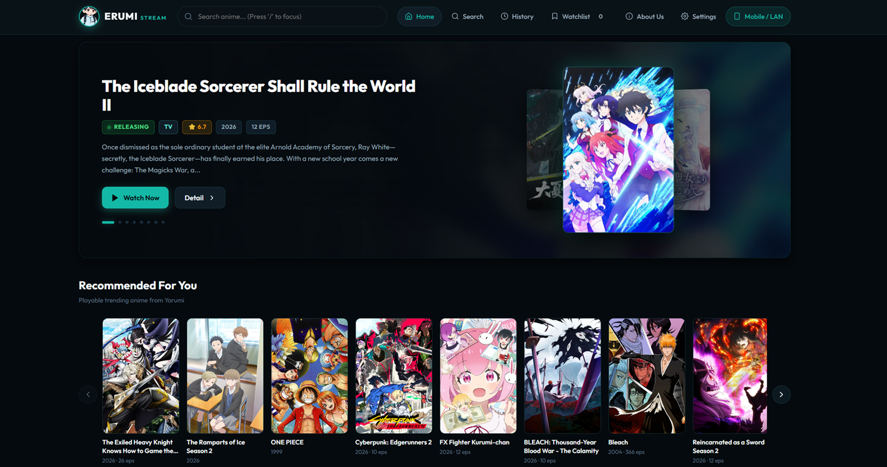
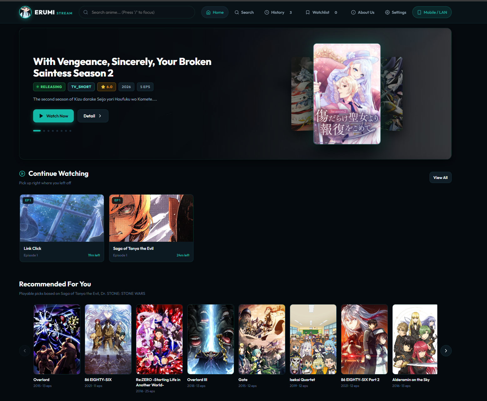
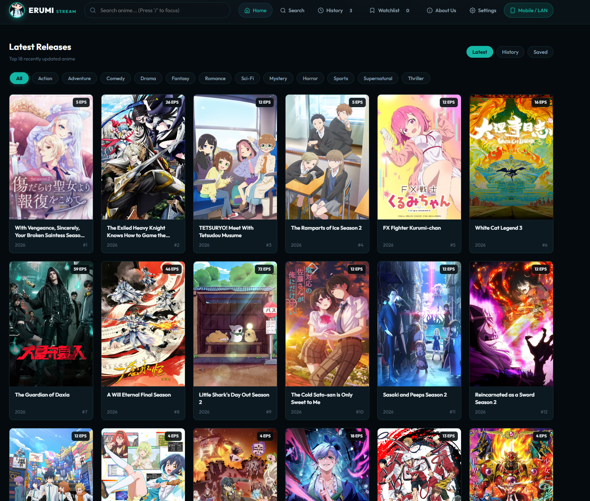
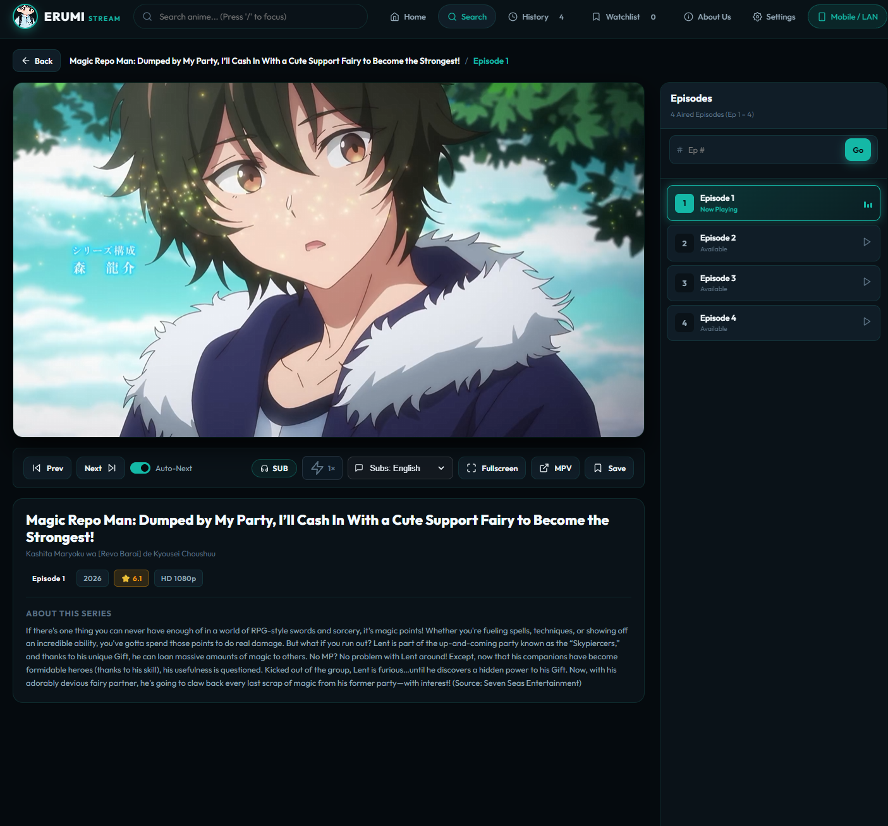
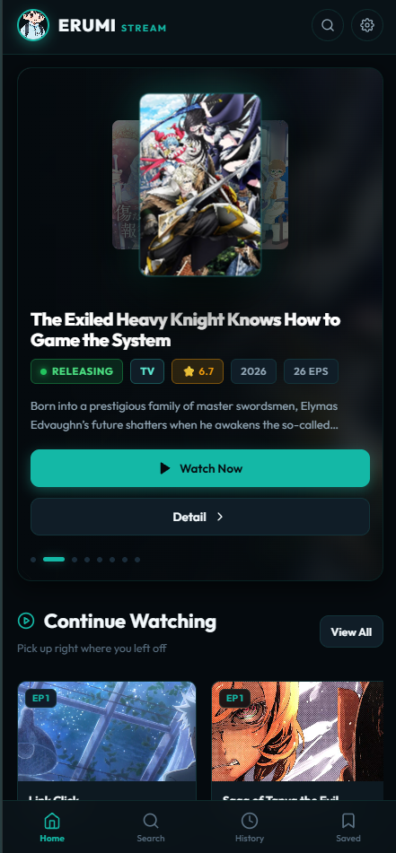
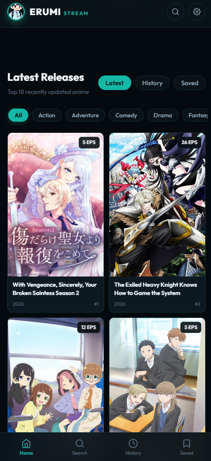
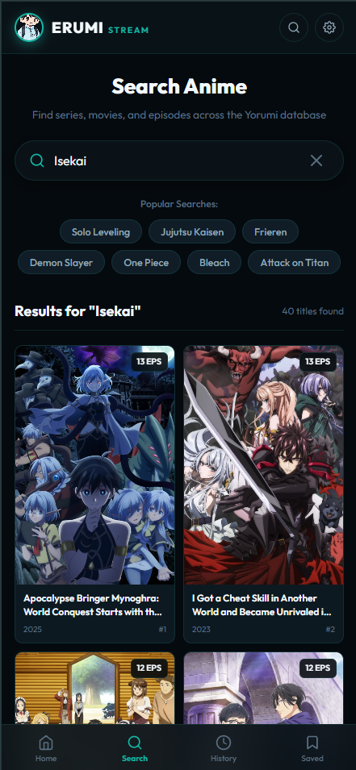
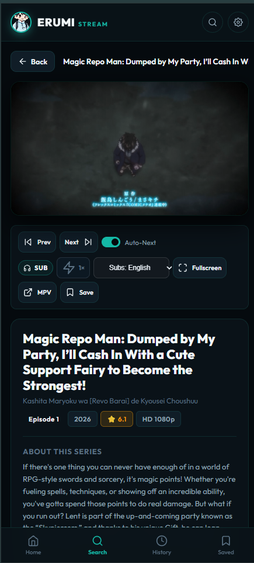
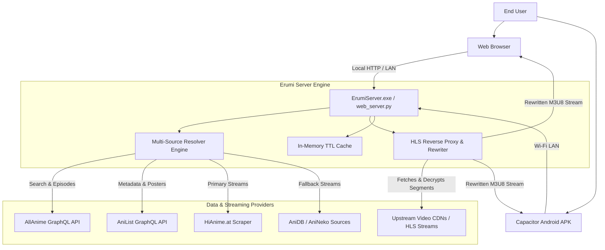

<div align="center">
  

  # E R U M I &nbsp; エルミ

  **A N I M E &nbsp; S T R E A M I N G &nbsp; P L A T F O R M**

  ---

  <br>

  
  
  
  
  
  
  
</div>

<br>

> A modern, cinema-grade anime streaming platform for Windows, Web, and Android — powered by the Yorumi engine. Ad-free, private, and blazing fast.

<br>

> [!CAUTION]
> ## ⚠️ EDUCATIONAL PURPOSE ONLY — HEAVY DISCLAIMER
>
> **PLEASE READ CAREFULLY BEFORE USING OR CONTRIBUTING:**
>
> 1. **No Content Ownership**: This project does **NOT** host, store, or distribute any copyrighted files (videos, images, or audio). All content is fetched in real-time from third-party publicly available sources (e.g., AllAnime, AniList, HiAnime).
> 2. **Educational Use**: This source code is strictly for **educational and research purposes**. It demonstrates modern Python GUI development, high-performance HTTP server architecture, HLS proxy streaming, and cross-platform web/APK deployment techniques.
> 3. **Legal Liability**: The developers and contributors of this repository assume **NO LIABILITY** for any misuse of this software. Users are solely responsible for ensuring their usage complies with local laws and the Terms of Service of the source websites.
> 4. **No Commercial Use**: This project is **NOT** for sale and should not be used for any commercial activities.

<br>


  


<br>

## ✨ Features

- **🎬 Unified Streaming Experience**: Seamlessly watch anime in-browser with HLS.js and auto-quality selection (1080p default).
- **📡 Web Server Mode (`ErumiServer.exe`)**:
    - Standalone desktop controller with an embedded Jellyfin-style local streaming backend.
    - Runs a high-performance HTTP server (`http://localhost:3000`) accessible across all devices on the same Wi-Fi.
    - **QR Code & LAN Share**: Scan the built-in QR code or copy the Wi-Fi link to stream immediately on phones, tablets, or Smart TVs.
- **⚡ Advanced Search & Scraper Engine**:
    - Multi-source search across **AllAnime GraphQL**, **AniList GraphQL**, and **HiAnime.at** with dynamic fallback pipelines.
    - **Smart Scoring & Fuzzy Matching**: Uses character bigram similarity and season/part consistency checks to eliminate false positives.
    - Browse **Latest Releases**, **Popular / Trending**, and genre categories (Action, Adventure, Fantasy, Romance, Sci-Fi, and more).
- **🚀 Performance First**:
    - **In-Memory Caching**: Server-side TTL caching for search results (1h), episode catalogs (10m), AniList metadata (12h), and HiAnime scrapers (15m).
    - **HLS Proxy Engine**: Automatically strips anti-hotlinking PNG disguise headers, rewrites `.m3u8` playlists, and injects appropriate referers.
    - **SSRF Protection**: Restricts stream proxying strictly to trusted public CDN endpoints and protects private RFC-1918 subnets.
- **🎨 Premium Cinema UI/UX**:
    - Glassmorphic dark cinema theme (`#050a0e` deep background with `#14b8a6` teal accents).
    - **3D Three-Card Carousel**: Smooth spotlight hero with auto-play, swipe gestures, and direct play buttons.
    - Fully responsive across desktop, tablet, and mobile browsers.
    - **Keyboard Navigation**: `Space` / `K` (play/pause), `F` (fullscreen), `M` (mute), `/` (instant search focus), and `←` / `→` (5s seek).
- **📚 User Library & Tracking**:
    - **Continue Watching Shelf**: Live episode resume cards with percentage progress bars.
    - **Watch History**: Local tracking of timestamps, remaining duration, and completed episodes.
    - **Watchlist & Bookmarks**: Save shows for later with one click.
    - Zero cloud requirement — all personal data lives securely in your local browser storage.
- **📱 Android APK & PWA**:
    - Native Android app powered by **Capacitor 7** with automatic landscape rotation in fullscreen.
    - PWA support with Service Worker (`sw.js`) and web manifest for offline shell caching and home-screen installation.
- **📝 Dual Subtitle Engine**: Custom WebVTT overlay renderer that maintains clean, readable subtitles across windowed mode and fullscreen views.

---

## 📸 Screenshots

### Desktop View
<table>
  <tr>
    <td width="50%">
      
      <p align="center"><b>Home & Featured Spotlight</b></p>
    </td>
    <td width="50%">
      
      <p align="center"><b>Latest Releases & Recommendations</b></p>
    </td>
  </tr>
  <tr>
    <td width="50%">
      
      <p align="center"><b>Anime Search & Filtering</b></p>
    </td>
    <td width="50%">
      
      <p align="center"><b>Cinema Player & Episode Selector</b></p>
    </td>
  </tr>
</table>

### Mobile Responsiveness
<table>
  <tr>
    <td width="25%"><p align="center"><b>Home</b></p></td>
    <td width="25%"><p align="center"><b>Latest Releases</b></p></td>
    <td width="25%"><p align="center"><b>Search</b></p></td>
    <td width="25%"><p align="center"><b>Cinema Watch</b></p></td>
  </tr>
</table>

---

## 🏗️ Architecture

Erumi operates across two distinct deployment modes — a native Desktop GUI pipeline and a local LAN Web Server with browser/mobile clients.



### 🛠️ Tech Stack

#### **Frontend (Web Application)**
- **Core**: Vanilla JavaScript (ES6+), HTML5 Semantic Shell, Modern CSS3 Variables
- **Streaming**: HLS.js (bundled for offline capability and APK bundling)
- **Icons**: Feather Icons (bundled SVG library)
- **Typography**: Google Fonts — *Outfit* (headings/display) and *JetBrains Mono* / *Consolas* (metadata/code)
- **Storage**: `localStorage` (history, watchlist, server preferences)

#### **Backend (Python Server & Controllers)**
- **Runtime**: Python 3.10+
- **HTTP Engine**: `http.server` & `socketserver` (zero heavy external web frameworks)
- **GUI Engine**: CustomTkinter (modern dark-themed Tkinter interface) with Tkinter fallback
- **Image Processing**: Pillow (mascot rendering, icon manipulation)
- **Concurrency**: Python `threading` & `queue.Queue` for non-blocking CLI processes
- **Security**: Built-in SSRF validation with strict CDN hostname whitelisting

#### **Web Server Playback Engine**
- **Web Server (`web_server.py`)**: Pure Python implementation with direct GraphQL and HTTP scrapers (AllAnime, AniList, HiAnime) with no Node.js runtime needed in web mode.

#### **Mobile & Build Tools**
- **Mobile Container**: Capacitor 7 (`@capacitor/core`, `@capacitor/android`, `@capacitor/splash-screen`)
- **Desktop Bundler**: PyInstaller (spec files for `Erumi.exe` and `ErumiServer.exe`)
- **Windows Installer**: Inno Setup Compiler (`erumi_installer.iss`)

---

## 🚀 Getting Started

### Prerequisites

Make sure the following tools are installed on your machine:
- **Python** (v3.10 or higher)
- **Node.js** (v18 or higher) — required for the Yorumi CLI stream resolver
- **mpv Media Player** — required for Desktop GUI playback (`main.py` / `Erumi.exe`)
- **Git**

### Installation

1. **Clone the Repository**
   ```bash
   git clone https://github.com/davenarchives/yorumi.git
   cd "yorumi anime streaming"
   ```

2. **Install Python Dependencies**
   ```bash
   pip install -r requirements.txt
   ```

3. **Install Node / Capacitor Dependencies (Optional for Android development)**
   ```bash
   npm install
   ```

---

### Running Locally

#### 1. Web Server Mode (Recommended for Web & LAN Streaming)

Run the desktop server controller:
```bash
python server_app.py
```
*Or launch directly via batch file:*
```bash
start_web.bat
```
- The server will bind to `http://localhost:3000` and automatically launch your default browser.
- Other phones, tablets, or computers on your Wi-Fi can connect directly via `http://<YOUR_PC_IP>:3000`.

#### 2. Desktop GUI Mode (Direct mpv Playback)

Run the CustomTkinter desktop interface:
```bash
python main.py
```
- Enter an anime title in the search field and press **Search**.
- Select your title and episode to immediately open and stream in **mpv**.

---

### 📦 Building Standalone Executables

#### Build Desktop GUI (`Erumi.exe`)
```bat
build.bat
```
Generates `dist\Erumi.exe`.

#### Build Server App (`ErumiServer.exe`)
```bat
build_server.bat
```
Generates `dist\ErumiServer.exe` and bundles all static `web/` and icon assets alongside the executable.

#### Build Complete Windows Setup Installer
Open and compile `erumi_installer.iss` using [Inno Setup](https://jrsoftware.org/isinfo.php) to produce `installer_output\ErumiStream_Setup_v2.8.2.exe`.

---

### 📱 Building the Android APK

1. **Sync Web Assets to Capacitor**:
   ```bash
   npx cap sync android
   ```
2. **Build Debug APK via Gradle**:
   ```bash
   cd android
   .\gradlew assembleDebug
   ```
   *Output APK location:* `android\app\build\outputs\apk\debug\app-debug.apk`

---

## 📁 Project Structure

```bash
yorumi anime streaming/
├── main.py                  # Standalone Desktop GUI (Erumi.exe)
├── server_app.py            # Server Controller App (ErumiServer.exe)
├── web_server.py            # High-performance HTTP Server, REST API & HLS Proxy
├── requirements.txt         # Python dependencies
│
├── web/                     # Web Application SPA
│   ├── index.html           # Main UI Shell (Browse, Search & Cinema Watch views)
│   ├── app.js               # ErumiApp Frontend Controller (Player, History, State)
│   ├── style.css            # Dark Cinema Theme stylesheet
│   ├── sw.js                # Service Worker for PWA offline caching
│   ├── hls.min.js           # Bundled HLS.js video engine
│   ├── feather.min.js       # Bundled Feather Icons library
│   └── site.webmanifest     # Progressive Web App manifest
│
├── web-loader/
│   └── index.html           # Capacitor bridge loader screen for Android APK
│
├── android/                 # Native Android Gradle Project (Capacitor)
├── capacitor.config.json    # Capacitor configuration
├── package.json             # Node.js and Capacitor scripts
│
├── build.bat                # PyInstaller build script for Desktop GUI
├── build_server.bat         # PyInstaller build script for Server App
├── build.spec               # PyInstaller spec definition for main.py
├── build_server.spec        # PyInstaller spec definition for server_app.py
├── erumi_installer.iss      # Inno Setup installation compiler script
├── start_web.bat            # Quick launch script for Web Server
│
├── erumi_config.json        # Runtime server and playback preferences
├── favicon/                 # Brand logos, icons, and splash images
└── dist/                    # Compiled binaries and release outputs
```

---

## 🤝 Contributing

Contributions are welcome! If you would like to help improve Erumi:

1. Fork the repository.
2. Create your feature branch: `git checkout -b feature/amazing-feature`.
3. Commit your changes: `git commit -m 'feat: Add amazing feature'`.
4. Push to the branch: `git push origin feature/amazing-feature`.
5. Open a Pull Request.

---

## 📄 License

Distributed under the MIT License. See `LICENSE` for more information.

---

<div align="center">

**Developed by Jhudel**

*Erumi Stream — Watch anime. Quietly.*

</div>

